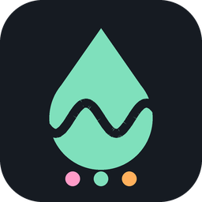
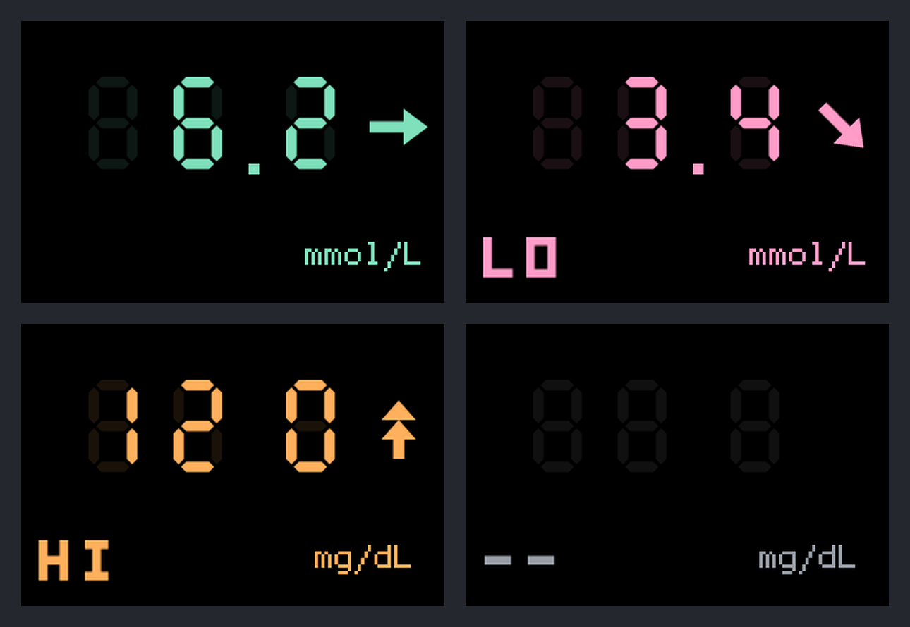
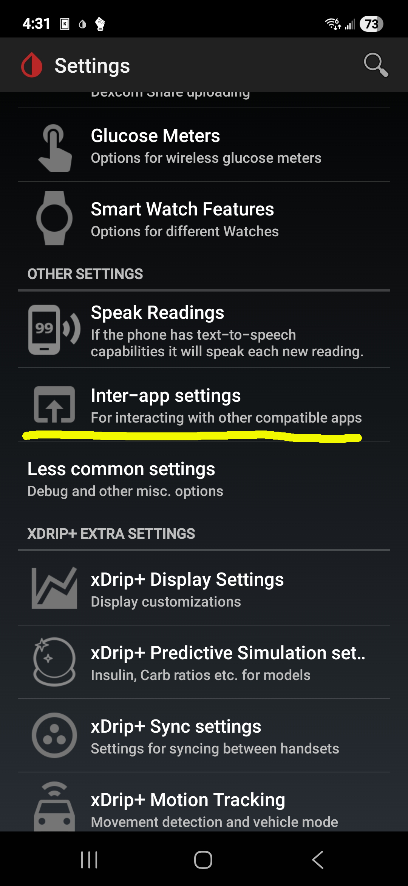
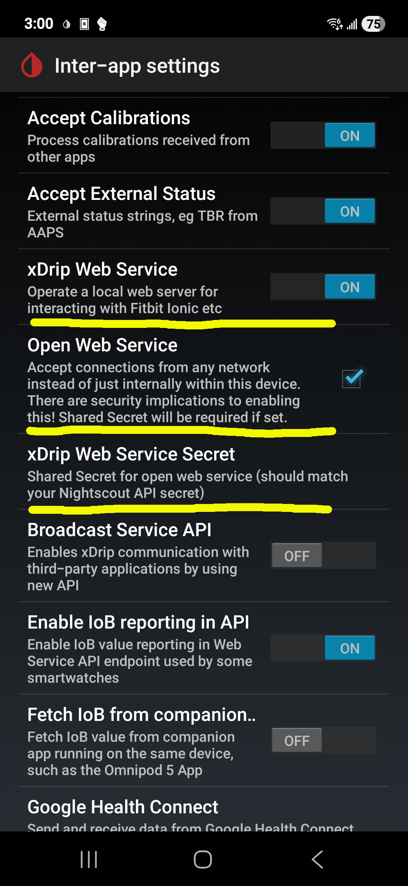
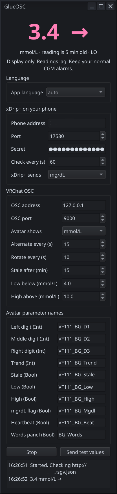
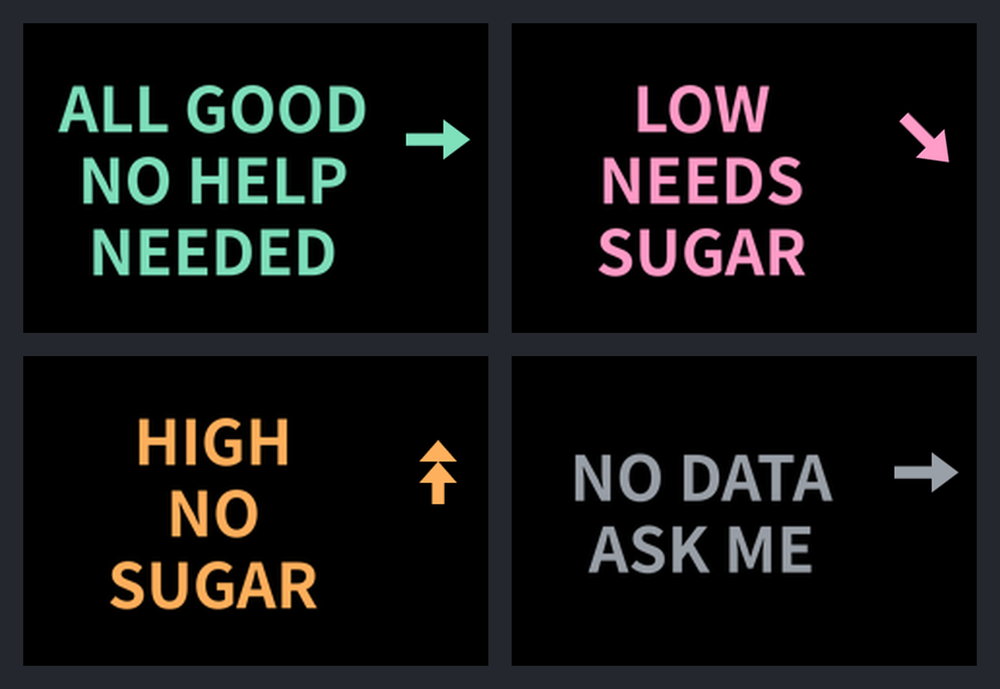

<p align="center"></p>

# GlucOSC

**Blood Sugar Meter to OSC translation software.**

GlucOSC reads your latest glucose reading from your phone and sends it over OSC, so your meter output is usable in VRChat. Other players see the number, a trend arrow, and a colour: pink for low, orange for high, green for in range, grey when the data is old. A plain-words mode is there for friends who don't know the numbers, great for teaching friends

> [!WARNING]
> **Display only.** CGM readings lag behind your real blood sugar, and this adds a little more delay. Keep your normal CGM alarms on. 

<p align="center"></p>

## How it works

```
CGM sensor -> phone app (e.g. Juggluco) -> xDrip+ (local web service) -> GlucOSC (PC) -> VRChat (OSC) -> avatar device
```

This guide assumes you're using **xDrip+**, but GlucOSC should work with any Nightscout server, because it reads the Nightscout-style `sgv.json` feed.

- xDrip+ documentation: <https://navid200.github.io/xDrip/>
- xDrip+ local web service (port, `sgv.json`, secret): [Local_Web_Services.md](https://github.com/NightscoutFoundation/xDrip/blob/master/Documentation/technical/Local_Web_Services.md)

## What you need

- A phone running xDrip+ on the same network as your PC.
- VRChat with OSC enabled: Action Menu > Options > OSC > Enabled.
- An avatar you can edit in Unity 2022.3 with the VRChat SDK (VRCFury or Modular Avatar recommended).

## 1. Set up xDrip+ on your phone

1. In xDrip+, open **Settings > Inter-app settings**.
2. Turn on **xDrip Web Service** and **Open Web Service**.
3. Set an **xDrip Web Service Secret** (any password). You will type the same one into GlucOSC.
4. Give your phone a fixed IP address on your router, so GlucOSC can always find it.

<p align="center"></p>
<p align="center"></p>

## 2. Install the bridge app on your PC

Download from the [latest release](../../releases/latest):

| System | File | How to run |
|---|---|---|
| Windows 10/11 (64-bit) | `GlucOSC-windows-x64.zip` | Unzip anywhere, run `GlucOSC.exe`. |
| Linux (x86_64) | `GlucOSC-x86_64.AppImage` | `chmod +x GlucOSC-x86_64.AppImage` then run it. |

**Windows SmartScreen:** the app is not code-signed (signing certificates cost money), so Windows may say "Windows protected your PC". Click **More info > Run anyway** only if the checksum matches (see [Check your download](#check-your-download)). **Do not ignore this step. Do not trust this just because you found it where you did. Always take due diligence with anything you download to avoid security pitfalls.**

Then in GlucOSC:

1. Type your phone's IP address and the secret from step 1.
2. Press **Start**. The big number should match your phone within a minute.
3. Choose what the avatar shows: mmol/L, mg/dL, **alternate** (switches unit every 15 s) or **rotate** (mmol/L, mg/dL, then plain words, 10 s each).

<p align="center"></p>

Running from source instead: `python3 src/glucose_osc_bridge.py` (needs Python 3.9+ and `pip install PySide6`). The `--cli` mode needs only Python.

## 3. Add the device to your avatar

1. In Unity, **Assets > Import Package > Custom Package** and choose `GlucOSC-Unity.unitypackage`. (Or unzip `GlucOSC-Unity.zip` into `Assets`.). Windows users can simply drag and drop into their folder structure. 
2. Open **Tools > Glucose Device > Open Builder** and follow the steps in the window.
3. Full instructions, options, and the VRCFury parameter-name fix: [unity/GlucoseDevice/README.md](unity/GlucoseDevice/README.md).
4. Parameter list and sync cost (39 bits of 256, plus optional extras): [unity/GlucoseDevice/PARAMETERS.txt](unity/GlucoseDevice/PARAMETERS.txt).

<p align="center"></p>

## Languages

The bridge app and the Unity builder are translated into English, French, Spanish, German, Japanese and Simplified Chinese. The avatar's plain-words panel also comes in Traditional Chinese, Korean, Brazilian Portuguese and Russian. **All translations were written by an AI and have not been checked by native speakers.** Corrections are very welcome, especially for the plain-words panel.

## Check your download

Every release includes `SHA256SUMS.txt` and a signed build record (provenance) from GitHub Actions, which shows the files were built by this repository's workflow from a specific commit.

Linux / macOS:
```
sha256sum -c SHA256SUMS.txt --ignore-missing
```
Windows (PowerShell), then compare with the line in `SHA256SUMS.txt`:
```
Get-FileHash .\GlucOSC-windows-x64.zip -Algorithm SHA256
```
With the [GitHub CLI](https://cli.github.com/) (checks the build record; put the release's version tag in place of `v0.1.0`):
```
gh attestation verify GlucOSC-windows-x64.zip --repo reploidsham/GlucOSC \
  --signer-workflow reploidsham/GlucOSC/.github/workflows/release.yml \
  --source-ref refs/tags/v0.1.0 --deny-self-hosted-runners
```
This only passes for files built by this repository's release workflow from a release tag.

## Building it yourself

See [docs/RELEASING.md](docs/RELEASING.md). Short version: `python3 packaging/lock_deps.py` once, then `bash packaging/build_appimage.sh` (Linux) or `pwsh packaging\build_windows.ps1` (Windows, PowerShell 7). Tests: `python3 tests/test_core.py` (and the other files in `tests/`). None of them need extra packages.

## Credits

Idea by **reploidsham**.
Built with Claude (Anthropic).

## AI User Disclaimer

I will admit readily that I do not know how to code. Most all of the code seen can be attributed to Claude, with my oversight and my personal testing. This means that if you find something that Claude did not, I will be open to your ideas and implementations. I did not do this to be an AI-bro. I had an idea that I wanted to realize that I thought would be potentially helpful to hundreds, if not thousands. 

## License

MIT, see [LICENSE](LICENSE). You may bundle the Unity device with your own avatars (free or paid); keep the `LICENSE.txt` file that comes with it. 

The Windows and Linux apps include Qt for Python (PySide6, LGPL-3.0) and other open-source parts; their licenses are in the `licenses` folder inside each download and listed in [THIRD-PARTY-NOTICES.md](THIRD-PARTY-NOTICES.md).
